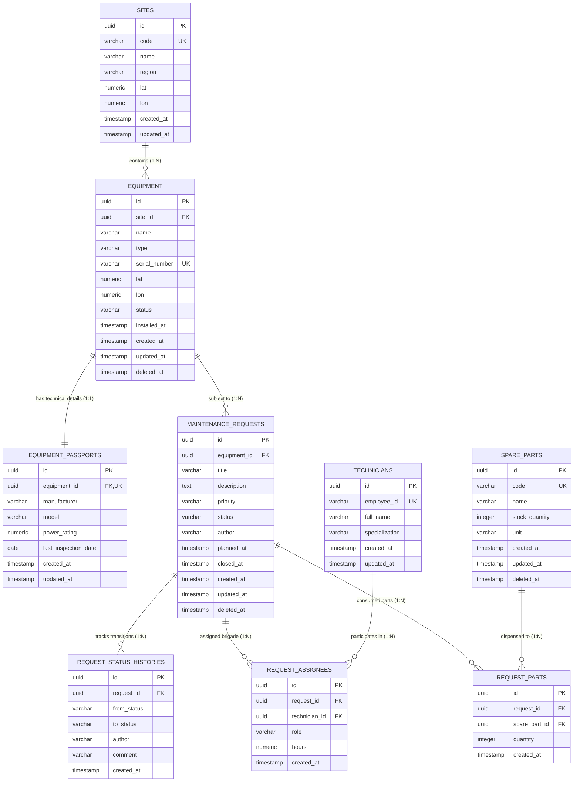

# REST API: Сервис учёта оборудования и заявок на техническое обслуживание (PostgreSQL 16, Sequelize ORM, 3NF, FSM & Аналитика)

Промышленный REST API сервис на платформе Express (Node.js) для комплексного учёта технологического оборудования производственных площадок (ветропарков, солнечных электростанций, распределительных подстанций), управления полным жизненным циклом заявок на техническое обслуживание (ТО), складского учёта запчастей, расчёта аналитических отчётов и предиктивного анализа пригодности погодного окна для безопасного проведения ремонтных работ.

Сервис спроектирован по канонической слоистой архитектуре («Layered Clean Architecture»), переведён с файлового JSON-хранилища на реляционную базу данных PostgreSQL 16 в третьей нормальной форме (3NF) под управлением Sequelize ORM, поддерживает транзакционный конечный автомат (FSM) с защитой от состояний гонки через строчные блокировки (`SELECT FOR UPDATE`), снабжён системой версионирования схемы (миграции и сиды) и полностью протестирован (Jest + Supertest, Postman).

---

## Содержание

1. [Архитектура и структура проекта](#1-архитектура-и-структура-проекта)
2. [Реляционная модель данных (3NF)](#2-реляционная-модель-данных-3nf)
   - 2.1 [Mermaid ER-диаграмма](#21-mermaid-er-диаграмма)
   - 2.2 [Обоснование нормализации до 3NF](#22-обоснование-нормализации-до-3nf)
   - 2.3 [Описание таблиц и связей](#23-описание-таблиц-и-связей)
3. [Транзакционный конечный автомат (FSM) и назначение бригад](#3-транзакционный-конечный-автомат-fsm-и-назначение-бригад)
4. [Складской учёт запчастей и транзакционное списание](#4-складской-учёт-запчастей-и-транзакционное-списание)
5. [Аналитические отчёты и оптимизация SQL-запросов](#5-аналитические-отчёты-и-оптимизация-sql-запросов)
6. [Миграции, откат и наполнение базы данных (Runbook)](#6-миграции-откат-и-наполнение-базы-данных-runbook)
7. [Требования к окружению и переменные среды](#7-требования-к-окружению-и-переменные-среды)
8. [Установка и запуск в Docker Compose](#8-установка-и-запуск-в-docker-compose)
9. [Спецификация REST API](#9-спецификация-rest-api)
10. [Единый формат ошибок API](#10-единый-формат-ошибок-api)
11. [Политики безопасности и защита данных](#11-политики-безопасности-и-защита-данных)
12. [Погодный модуль и правила пригодности наружных работ](#12-погодный-модуль-и-правила-пригодности-наружных-работ)
13. [Клиентский веб-интерфейс (Fetch API)](#13-клиентский-веб-интерфейс-fetch-api)
14. [Автоматизированное тестирование (Jest + Supertest)](#14-автоматизированное-тестирование-jest--supertest)
15. [Тестирование в Postman](#15-тестирование-в-postman)

---

## 1. Архитектура и структура проекта

Приложение организовано по классической четырёхуровневой слоистой архитектуре с однонаправленным потоком управления и строгим разделением ответственности:

```
Клиентский запрос (HTTP / REST)
       │
       ▼
[Middlewares Конвейер] ── (Request-ID → Logger → Helmet → CORS → Rate Limit → Cookie → BodyParser → Auth)
       │
       ▼
[Routes (Маршрутизация)] ── Декларация путей и валидация схем через Zod (req.valid)
       │
       ▼
[Controllers (Контроллеры)] ── Обработка HTTP, статус-коды, заголовки (Location)
       │
       ▼
[Services (Бизнес-логика)] ── Транзакции, FSM, бизнес-правила бригад, списание запчастей, погода
       │
       ▼
[Repositories & Sequelize Models] ── Пул подключений, ORM-сущности, сырые SQL-запросы
       │
       ▼
[PostgreSQL 16 RDBMS] ── 3NF Схема, внешние ключи, B-Tree индексы, строчные блокировки
```

### Структура каталогов

```
case_2/
├── docs/                               # Документация и артефакты
│   └── postman/                        # Коллекции и переменные окружения Postman
│       ├── caselab-case3.postman_collection.json
│       ├── caselab-case3.postman_environment.json
│       ├── caselab-case2.postman_collection.json
│       └── caselab-case2.postman_environment.json
├── public/                             # Статический клиентский интерфейс (Fetch API)
│   ├── app.js
│   ├── index.html
│   └── styles.css
├── scripts/
│   └── migrate-legacy-json.js          # Скрипт миграции исторических JSON-данных в PostgreSQL
├── src/
│   ├── app.js                          # Сборка Express-приложения без привязки к сокету
│   ├── server.js                       # Точка запуска HTTP-сервера и Graceful Shutdown
│   ├── config/
│   │   ├── database.js                 # Конфигурация пула соединений Sequelize к PostgreSQL
│   │   └── env.js                      # Централизованная типизация и валидация .env
│   ├── controllers/
│   │   ├── equipment.controller.js     # CRUD оборудования
│   │   ├── part.controller.js          # Каталог запчастей
│   │   ├── report.controller.js        # Аналитические SQL-отчёты
│   │   ├── request.controller.js       # Жизненный цикл заявок, бригады, история, запчасти
│   │   ├── site.controller.js          # Сводка по производственным площадкам
│   │   └── weather.controller.js       # Оценка погодных условий
│   ├── db/
│   │   ├── migrator.js                 # Движок миграций (up, down, status)
│   │   ├── seed.js                     # Наполнение и очистка демонстрационных данных
│   │   ├── migrations/                 # Миграции схемы БД (01..09)
│   │   │   ├── 01_create_sites.js
│   │   │   ├── 02_create_equipment.js
│   │   │   ├── 03_create_equipment_passports.js
│   │   │   ├── 04_create_technicians.js
│   │   │   ├── 05_create_maintenance_requests.js
│   │   │   ├── 06_create_request_status_history.js
│   │   │   ├── 07_create_request_assignees.js
│   │   │   ├── 08_create_spare_parts_and_usages.js
│   │   │   └── 09_create_performance_indexes.js
│   │   └── models/                     # Sequelize ORM модели
│   │       ├── Equipment.js
│   │       ├── EquipmentPassport.js
│   │       ├── MaintenanceRequest.js
│   │       ├── RequestAssignee.js
│   │       ├── RequestPart.js
│   │       ├── RequestStatusHistory.js
│   │       ├── Site.js
│   │       ├── SparePart.js
│   │       ├── Technician.js
│   │       └── index.js                # Ассоциации и связи моделей
│   ├── errors/                         # Иерархия доменных классов ошибок
│   │   └── index.js
│   ├── middlewares/
│   │   ├── auth.js                     # Аутентификация мутирующих операций (API-Key / Cookie)
│   │   ├── cors.js                     # CORS с проверкой белого списка
│   │   ├── errorHandler.js             # Централизованный обработчик ошибок (RFC 9457)
│   │   ├── logger.js                   # Асинхронное логирование Pino-HTTP
│   │   ├── notFound.js                 # Обработка несуществующих маршрутов (404)
│   │   ├── rateLimiter.js              # Ограничение частоты запросов (429)
│   │   ├── requestId.js                # Сквозная трассировка (UUID + X-Request-ID)
│   │   └── validate.js                 # Валидация body/query/params через Zod
│   ├── repositories/
│   │   ├── index.js                    # Фабрика репозиториев
│   │   ├── interfaces/                 # Интерфейсы репозиториев
│   │   │   ├── EquipmentRepository.js
│   │   │   └── RequestRepository.js
│   │   └── sequelize/                  # Реализация репозиториев поверх Sequelize
│   │       ├── SequelizeEquipmentRepository.js
│   │       └── SequelizeRequestRepository.js
│   ├── services/                       # Слой бизнес-логики
│   │   ├── EquipmentService.js
│   │   ├── PartService.js
│   │   ├── RequestService.js
│   │   ├── WeatherService.js
│   │   └── index.js
│   └── validators/                     # Zod-схемы входных данных
│       ├── equipment.schema.js
│       ├── part.schema.js
│       ├── report.schema.js
│       ├── request.schema.js
│       └── site.schema.js
├── tests/
│   ├── setup.js                        # Настройка изолированной тестовой БД и очистка таблиц
│   ├── integration/
│   │   ├── analytics-and-reports.test.js
│   │   ├── assignees-and-transactions.test.js
│   │   ├── equipment-api.test.js
│   │   ├── requests-api.test.js
│   │   ├── security-and-logging.test.js
│   │   ├── spare-parts-inventory.test.js
│   │   ├── weather-api.test.js
│   │   └── web-static.test.js
│   └── unit/
│       ├── validation-and-errors.test.js
│       └── weather-service.test.js
├── Dockerfile
├── docker-compose.yml
├── eslint.config.js
├── package.json
└── README.md
```

---

## 2. Реляционная модель данных (3NF)

### 2.1. Mermaid ER-диаграмма



### 2.2. Обоснование нормализации до 3NF

Исходная денормализованная модель хранения (Кейс 2) содержала массивы и составные объекты в рамках плоских JSON-документов. При переходе на реляционную модель проведена последовательная нормализация:

1. **Первая нормальная форма (1NF)**:
   - Все поля атомарны (скалярные типы).
   - Устранены массивы исполнителей и вложенные структуры внутри таблицы заявок.
   - Каждая таблица имеет уникальный первичный ключ (`id` типа `UUIDv4`).

2. **Вторая нормальная форма (2NF)**:
   - Выполнены требования 1NF.
   - Все неключевые атрибуты функционально полно зависят от первичного ключа.
   - **Выделение `equipment_passports` (1:1)**: Паспортные технические характеристики оборудования (производитель, заводская модель, электрическая мощность, дата техосмотра) вынесены из таблицы оперативного учёта `equipment`. Это оптимизирует чтение оперативных данных оборудования без накладных расходов на чтение паспортных данных.
   - **Выделение `sites` (1:N)**: Производственные площадки (название ветропарка, региональная принадлежность, базовые координаты) отделены от оборудования. Это устраняет аномалии дублирования данных площадки при добавлении сотен единиц оборудования на одном объекте.

3. **Третья нормальная форма (3NF)**:
   - Выполнены требования 2NF.
   - Устранены транзитивные функциональные зависимости (неключевой атрибут не зависит от другого неключевого атрибута):
     - **Специалисты (`technicians`) и бригады (`request_assignees`, M:N)**: Данные специалистов (ФИО, табельный номер, специальность) хранятся в `technicians`. Назначение специалиста на заявку оформлено через соединительную таблицу `request_assignees` с собственными контекстными атрибутами (`role`: `lead` / `member`, `assigned_hours`). Это исключает обновление ФИО инженера во всех его заявках.
     - **Аудит смены статусов (`request_status_histories`)**: История переходов жизненного цикла вынесена в отдельный лог событий (1:N), фиксирующий точный момент смены статуса, автора изменения и комментарий.
     - **Складской учёт (`spare_parts` и `request_parts`, M:N)**: Номенклатура запчастей и остатки на складе нормализованы в `spare_parts`. Расход деталей на проведение ремонтных работ по конкретной заявке регистрируется в связующей таблице `request_parts`.

---

## 3. Транзакционный конечный автомат (FSM) и назначение бригад

### Жизненный цикл заявки

```
      ┌─────────────┐
      │     new     │
      └──────┬──────┘
             │ (Требуется бригада: ровно 1 lead)
      ┌──────┴──────────────┐
      ▼                     ▼
┌─────────────┐       ┌─────────────┐
│ in_progress │       │  rejected   │ ◄── [Финальный статус]
└──────┬──────┘       └─────────────┘
       │                     ▲
       ├─────────────────────┘
       ▼
┌─────────────┐
│    done     │ ◄── [Финальный статус: фиксируется closed_at]
└─────────────┘
```

### Бизнес-правила и транзакционная целостность

1. **Инвариант назначения бригады (`POST /api/requests/:id/assignees`)**:
   - На заявку может быть назначена бригада технических специалистов.
   - В составе бригады **обязан присутствовать ровно 1 ведущий специалист** (`role: 'lead'`). Нарушение условия (0 или $>1$ lead) отклоняется с кодом `422 Unprocessable Content`.
   - Если указан несуществующий специалист, операция прерывается с кодом `404 Not Found`.
   - Повторное указание одного и того же специалиста в составе бригады отклоняется с кодом `409 Conflict`.
2. **Инвариант перевода в работу**:
   - Перевод заявки из статуса `new` в статус `in_progress` **запрещён**, если на заявку не назначена бригада специалистов. Попытка перевода возвращает `409 Conflict`.
3. **Защита от состояний гонки (Race Conditions)**:
   - Смена статуса выполняется в рамках базы данных PostgreSQL внутри изолированной транзакции (`sequelize.transaction`).
   - Для блокировки строки заявки на время проверки переходов и сохранения истории используется механизм пессимистичной строчной блокировки:
     ```sql
     SELECT * FROM maintenance_requests WHERE id = :id FOR UPDATE;
     ```
   - За счёт этого исключаются конфликты параллельных конкурирующих запросов на закрытие/отклонение заявки.
4. **Автоматический аудит**:
   - Каждое изменение статуса атомарно записывается в таблицу `request_status_histories`.
   - При переводе в статус `done` в строке заявки автоматически выставляется таймстемп `closed_at`.

---

## 4. Складской учёт запчастей и транзакционное списание

Для контроля комплектующих и расходных материалов реализована подсистема складского учёта:

- **Каталог запчастей (`/api/parts`)**: регистрация наименований, уникальных артикулов (`code`), единиц измерения (`unit`) и текущего складского остатка (`stockQuantity`).
- **Списание по заявке (`POST /api/requests/:id/parts`)**:
  - Запрос принимает идентификатор запчасти (`partId`) и требуемое количество (`quantity`).
  - Выполняется строчная блокировка записи запчасти на уровне PostgreSQL:
    ```sql
    SELECT * FROM spare_parts WHERE id = :partId FOR UPDATE;
    ```
  - Проверяется доступный остаток: `part.stockQuantity >= requestedQuantity`.
  - При нехватке деталей транзакция **немедленно откатывается (ROLLBACK)** и клиенту возвращается понятный ответ `409 Conflict` (например: _«Недостаточно запчастей "Фильтр масляный" на складе. Доступно: 2, запрошено: 5»_).
  - При достаточном количестве: остаток декрементируется, создаётся связующая запись в `request_parts`, а транзакция коммитится.

---

## 5. Аналитические отчёты и оптимизация SQL-запросов

### 5.1. Аналитическая сводка по площадке (`GET /api/sites/:id/summary`)

Возвращает агрегированную информацию по производственному объекту:
- Общее количество зарегистрированного оборудования на объекте.
- Общее количество заявок на ТО.
- Распределение заявок по статусам (`new`, `in_progress`, `done`, `rejected`).
- Распределение заявок по приоритетам (`low`, `medium`, `high`, `critical`).
- Среднее время выполнения закрытых заявок в часах (`avgCompletionHours`).

### 5.2. Отчёт по загрузке оборудования ТО (`GET /api/reports/equipment-load`)

Сложный аналитический сырой SQL-запрос, соединяющий 4 таблицы базы данных:
- `equipment` (основные данные оборудования)
- `sites` (наименование площадки размещения)
- `equipment_passports` (паспортная модель и производитель)
- `maintenance_requests` (статистика заявок)

```sql
SELECT
  e.id AS "equipmentId",
  e.name AS "equipmentName",
  e.serial_number AS "serialNumber",
  e.type AS "type",
  e.status AS "status",
  s.name AS "siteName",
  p.model AS "model",
  COUNT(r.id)::int AS "requestsCount",
  COUNT(CASE WHEN r.status = 'in_progress' THEN 1 END)::int AS "activeRequestsCount",
  COUNT(CASE WHEN r.status = 'done' THEN 1 END)::int AS "completedRequestsCount",
  MAX(r.created_at) AS "lastRequestCreatedAt"
FROM equipment e
LEFT JOIN sites s ON e.site_id = s.id
LEFT JOIN equipment_passports p ON p.equipment_id = e.id
LEFT JOIN maintenance_requests r ON r.equipment_id = e.id AND r.deleted_at IS NULL
WHERE e.deleted_at IS NULL
GROUP BY e.id, e.name, e.serial_number, e.type, e.status, s.name, p.model
HAVING COUNT(r.id) >= :minRequests
ORDER BY "requestsCount" DESC
LIMIT :limit OFFSET :offset;
```

### 5.3. Оптимизация производительности и план выполнения (`EXPLAIN ANALYZE`)

Для обеспечения быстродействия на масштабных объёмах данных миграция `09_create_performance_indexes.js` создаёт специализированные B-Tree индексы:
1. `idx_equipment_site_id` на `equipment(site_id)` — быстрый `JOIN` с таблицей площадок.
2. `idx_equipment_type_status` (составной) на `equipment(type, status)` — ускорение фильтрации каталога оборудования.
3. `idx_requests_equipment_id` на `maintenance_requests(equipment_id)` — оптимизация соединений и расчёта агрегатов `COUNT(r.id)`.
4. `idx_requests_status_created_at` (составной) на `maintenance_requests(status, created_at)` — ускорение фильтрации журналов заявок и выборки истории.
5. `idx_request_assignees_req_tech` (составной уникальный) на `request_assignees(request_id, technician_id)` — мгновенная проверка дубликатов специалистов в бригаде.
6. `idx_request_parts_req_part` (составной) на `request_parts(request_id, spare_part_id)` — ускорение выборки номенклатуры списания.

План выполнения запроса с использованием `EXPLAIN (ANALYZE, BUFFERS)` подтверждает замену медленного полного сканирования таблицы (`Seq Scan`) на эффективный `Index Scan` / `Bitmap Index Scan` с объединением через `HashAggregate` по сгруппированным ключам.

---

## 6. Миграции, откат и наполнение базы данных (Runbook)

Управление схемой базы данных построено без использования внешнего CLI через встроенный модуль `src/db/migrator.js` с фиксацией выполненных миграций в служебной таблице `SequelizeMeta`:

### Применение миграций

```bash
npm run db:migrate
```
Выполняет накатывание всех неприменённых файлов миграций из папки `src/db/migrations/` в строгой транзакционной последовательности (от `01` до `09`).

### Проверка статуса миграций

```bash
npm run db:migrate:status
```
Выводит в консоль перечень всех доступных миграций с отметками об их текущем статусе (`APPLIED` / `PENDING`).

### Откат миграций

```bash
# Откат ровно одной последней применённой миграции
npm run db:migrate:undo

# Полный откат всех миграций схемы
npm run db:migrate:undo:all
```

### Наполнение демонстрационными данными (Seeds)

```bash
# Наполнение базы демонстрационными площадками, оборудованием, паспортами, специалистами и заявками
npm run db:seed

# Очистка демонстрационных данных
npm run db:seed:undo
```

### Импорт исторических данных из JSON (Кейс 2 -> Кейс 3)

```bash
npm run db:migrate-legacy
```
Скрипт `scripts/migrate-legacy-json.js` анализирует файлы `data/equipment.json` и `data/requests.json`, создаёт базовую площадку по умолчанию, транслирует единицы оборудования и заявки в таблицы PostgreSQL с сохранением их оригинальных `id`, дат создания и привязкой паспортных данных.

---

## 7. Требования к окружению и переменные среды

- **Node.js**: версия `20.0.0` или выше (ESM, нативный `fetch`, `node:crypto`).
- **npm**: версия `9.0.0` или выше.
- **PostgreSQL**: версия `16.0` или выше (рекомендуется запуск через прилагаемый `docker-compose.yml`).

### Конфигурация `.env`

Все параметры валидируются через Zod в `src/config/env.js`:

| Переменная                  |   Тип    | Назначение                                                  | Значение по умолчанию                         |
| :-------------------------- | :------: | :---------------------------------------------------------- | :-------------------------------------------- |
| `PORT`                      | `number` | Сетевой порт HTTP-сервера                                   | `3000`                                        |
| `NODE_ENV`                  | `string` | Режим работы (`development`, `production`, `test`)          | `development`                                 |
| `DB_HOST`                   | `string` | Хост сервера PostgreSQL                                    | `localhost`                                   |
| `DB_PORT`                   | `number` | Порт PostgreSQL                                             | `5432`                                        |
| `DB_NAME`                   | `string` | Имя основной базы данных                                    | `caselab_db`                                  |
| `DB_USER`                   | `string` | Пользователь БД                                             | `caselab_user`                                |
| `DB_PASSWORD`               | `string` | Пароль пользователя БД                                      | `caselab_password`                            |
| `DB_LOGGING`                | `boolean`| Вывод SQL-запросов в лог                                    | `false`                                       |
| `DB_POOL_MAX`               | `number` | Максимальный размер пула соединений                         | `10`                                          |
| `DB_POOL_MIN`               | `number` | Минимальный размер пула соединений                          | `2`                                           |
| `CORS_ORIGINS`              | `string` | Белый список источников CORS через запятую                  | `http://localhost:3000,http://127.0.0.1:3000` |
| `RATE_LIMIT_WINDOW_MS`      | `number` | Окно ограничения частоты запросов (мс)                      | `60000` (1 минута)                            |
| `RATE_LIMIT_MAX_REQUESTS`   | `number` | Лимит запросов с одного IP на окно                          | `100`                                         |
| `WEATHER_API_URL`           | `string` | URL погодного API Open-Meteo                                | `https://api.open-meteo.com/v1/forecast`      |
| `REQUEST_TIMEOUT_MS`        | `number` | Таймаут сетевых запросов (мс)                               | `5000`                                        |
| `API_KEY`                   | `string` | Секретный ключ для мутирующих запросов                      | `""` (в dev не блокирует вызовы)              |

---

## 8. Установка и запуск в Docker Compose

### 1. Подготовка конфигурации

```bash
cp .env.example .env
```

### 2. Запуск контейнеров с базой данных и сервисом

```bash
docker compose up -d --build
```
Команда запускает:
- Контейнер СУБД `caselab-postgres` (PostgreSQL 16 Alpine) с настроенным Healthcheck.
- Контейнер веб-сервиса `caselab-app` с ожиданием готовности СУБД.

### 3. Накатывание миграций и демонстрационных данных в контейнере

```bash
# Применение миграций
docker compose exec app npm run db:migrate

# Заполнение демонстрационными данными
docker compose exec app npm run db:seed
```

Сервис готов к обработке входящих запросов по адресу `http://localhost:3000/`.

---

## 9. Спецификация REST API

### 9.1. Системные и аналитические эндпоинты

| Метод | Путь                           | Описание                                                            | Коды ответов |
| :---- | :----------------------------- | :------------------------------------------------------------------ | :----------- |
| `GET` | `/api/health`                  | Проверка жизнеспособности сервиса и доступности подключения к СУБД  | 200, 503     |
| `GET` | `/api/sites/:id/summary`       | Сводный аналитический отчёт по площадке (статусы, среднее время ТО) | 200, 404     |
| `GET` | `/api/reports/equipment-load`  | Аналитический SQL-отчёт загрузки оборудования с фильтром HAVING     | 200, 400     |

### 9.2. Оборудование (`/api/equipment`)

| Метод    | Путь                          | Описание                                                  | Коды ответов      |
| :------- | :---------------------------- | :-------------------------------------------------------- | :---------------- |
| `GET`    | `/api/equipment`              | Список оборудования с пагинацией и фильтрацией            | 200               |
| `POST`   | `/api/equipment`              | Регистрация новой единицы оборудования                    | 201, 400, 409     |
| `GET`    | `/api/equipment/:id`          | Детальные сведения об оборудовании и паспорте             | 200, 404          |
| `PATCH`  | `/api/equipment/:id`          | Частичное обновление параметров оборудования              | 200, 400, 404     |
| `DELETE` | `/api/equipment/:id`          | Мягкое удаление (блокируется при активных заявках на ТО)  | 204, 404, 409     |
| `GET`    | `/api/equipment/:id/requests` | Список заявок по конкретному оборудованию                 | 200, 404          |
| `GET`    | `/api/equipment/:id/weather`  | Оценка погодного окна для проведения наружных работ       | 200, 404, 502     |

### 9.3. Заявки на техническое обслуживание (`/api/requests`)

| Метод    | Путь                             | Описание                                                      | Коды ответов      |
| :------- | :------------------------------- | :------------------------------------------------------------ | :---------------- |
| `GET`    | `/api/requests`                  | Список заявок с пагинацией, фильтрацией и сортировкой         | 200               |
| `POST`   | `/api/requests`                  | Регистрация новой заявки на ТО                                | 201, 400, 404     |
| `POST`   | `/api/requests/bulk`             | Пакетный импорт заявок                                        | 207 Multi-Status  |
| `GET`    | `/api/requests/:id`              | Просмотр заявки с привязанной бригадой и запчастями           | 200, 404          |
| `PATCH`  | `/api/requests/:id`              | Редактирование темы, описания и плановой даты                 | 200, 400, 404     |
| `PATCH`  | `/api/requests/:id/status`       | Транзакционная смена статуса по конечному автомату (FSM)      | 200, 400, 404, 409|
| `DELETE` | `/api/requests/:id`              | Мягкое удаление заявки (Soft Delete)                          | 204, 404          |
| `POST`   | `/api/requests/:id/assignees`    | Назначение бригады специалистов (строго 1 lead)               | 200, 404, 409, 422|
| `DELETE` | `/api/requests/:id/assignees/:userId` | Снятие специалиста с заявки                             | 204, 404          |
| `GET`    | `/api/requests/:id/history`      | Полный аудит-журнал переходов статусов заявки                 | 200, 404          |
| `POST`   | `/api/requests/:id/parts`        | Списание запчастей со склада по заявке                        | 201, 404, 409     |
| `GET`    | `/api/requests/:id/parts`        | Список списанных по заявке запчастей                          | 200, 404          |

### 9.4. Запчасти и складской учёт (`/api/parts`)

| Метод  | Путь             | Описание                                                | Коды ответов      |
| :----- | :--------------- | :------------------------------------------------------ | :---------------- |
| `GET`  | `/api/parts`     | Каталог запчастей с поиском по названию/коду и остатком | 200               |
| `POST` | `/api/parts`     | Регистрация новой номенклатурной позиции запчасти       | 201, 400, 409     |
| `GET`  | `/api/parts/:id` | Просмотр сведений о запчасти по идентификатору          | 200, 404          |

---

## 10. Единый формат ошибок API

Все ошибки сериализуются в строгом соответствии с концепцией RFC 9457:

```json
{
  "error": {
    "code": "CONFLICT",
    "message": "Перевод заявки в статус \"in_progress\" невозможен без назначенной бригады специалистов",
    "details": [],
    "requestId": "9c8b7a6d-5e4f-3a2b-1c0d-e9f8a7b6c5d4"
  }
}
```

- `code` — машиночитаемый строковый код категории ошибки (`VALIDATION_ERROR`, `NOT_FOUND`, `CONFLICT`, `UNPROCESSABLE_ENTITY`, `TOO_MANY_REQUESTS`, `INTERNAL_SERVER_ERROR`).
- `message` — понятное локализованное описание причины сбоя на русском языке.
- `details` — массив конкретных несоответствий при валидации схемы (с указанием поля).
- `requestId` — сквозной идентификатор запроса для трассировки в логах.

---

## 11. Политики безопасности и защита данных

- **Helmet**: автоматическая установка защитных HTTP-заголовков (`X-Content-Type-Options: nosniff`, `X-Frame-Options: SAMEORIGIN`, HSTS).
- **CORS**: строгий белый список доверенных источников `CORS_ORIGINS`.
- **Rate Limiting**: защита от флуда и перегрузки через `express-rate-limit` (100 запросов в минуту с отдачей стандартных заголовков `RateLimit-*`).
- **Payload Limits**: ограничение входящего тела запроса (`express.json({ limit: '100kb' })`) для предотвращения DoS-атак.
- **Cookie Security**: установка сессионных кук с флагами `HttpOnly`, `SameSite=Strict`, `Secure`.
- **SQL Injection Prevention**: исключение конкатенации сырых строк; использование параметризованных запросов и строгой валидации полей сортировки по белому списку в контроллерах аналитики.

---

## 12. Погодный модуль и правила пригодности наружных работ

Модуль `WeatherService` оценивает безопасность проведения наружных высотных работ на оборудовании на основе суточного прогноза Open-Meteo:

Погодное окно признаётся **пригодным** (`feasible: true`), только если одновременно соблюдены условия:
$$\text{Precipitation} \le 1.0 \text{ мм}, \quad \text{WindSpeed} \le 12.0 \text{ км/ч}, \quad -15.0 \text{ °C} \le \text{Temp} \le 35.0 \text{ °C}$$

При нарушении порогов сервис возвращает детальное обоснование причин непригодности на русском языке.

---

## 13. Клиентский веб-интерфейс (Fetch API)

В каталоге `public/` размещён статический веб-клиент на чистом HTML5/CSS3/Vanilla JS без сторонних фреймворков. Приложение обращается к серверу через нативный `Fetch API` и предоставляет:
- Индикатор доступности API и базы данных в реальном времени (`/api/health`).
- Регистрацию оборудования и создание заявок на обслуживание.
- Просмотр каталога оборудования и текущего статуса агрегатов.
- Интерактивный перевод статусов заявок в соответствии с правилами FSM.

---

## 14. Автоматизированное тестирование (Jest + Supertest)

Проект содержит 10 тестовых сьютов (82 теста) с полным покрытием модульной и интеграционной логики.

### Изоляция тестовой базы данных (`tests/setup.js`)

Интеграционные тесты выполняются против выделенной тестовой базы `caselab_db_test`. Перед запуском каждого тестового сьюта модуль `tests/setup.js`:
- Накатывает полную актуальную схему БД.
- Выполняет быструю очистку таблиц:
  ```sql
  TRUNCATE TABLE sites, equipment, equipment_passports, technicians,
                 maintenance_requests, request_status_histories,
                 request_assignees, spare_parts, request_parts
  CASCADE;
  ```
- Гарантирует абсолютную чистоту данных и независимость тестов от порядка их запуска.

### Запуск тестов и линтеров

```bash
# Запуск всех тестов
npm test

# Запуск с генерацией отчёта покрытия кода
npm run test:coverage

# Проверка стиля кода ESLint
npm run lint

# Автоматическое форматирование Prettier
npm run format
```

---

## 15. Тестирование в Postman

В каталоге `docs/postman/` подготовлены коллекция и окружение для сквозного тестирования:
- `caselab-case3.postman_collection.json`
- `caselab-case3.postman_environment.json`

### Порядок тестирования

1. Запустите сервис (`npm start` или `docker compose up -d`).
2. Наполните базу демонстрационными данными: `npm run db:seed`.
3. Откройте Postman, нажмите **Import** и выберите оба файла из папки `docs/postman/`.
4. Активируйте окружение **CaseLab - Case 3 (PostgreSQL & Sequelize)**.
5. Запустите автоматический прогон через **Collection Runner**.

### Состав коллекции и автоматизированные проверки `pm.test`

Коллекция сгруппирована по тематическим папкам и содержит автотесты для всех ключевых сценариев:
- **0. System & Health**: проверка статуса `database: "connected"`.
- **1. Equipment & Sites**: создание оборудования, сохранение идентификатора в `tempEquipmentId`, сводка по площадке `/api/sites/:id/summary`.
- **2. Requests & Lifecycle FSM**: создание заявки, пакетный импорт `207 Multi-Status`, журнал аудита истории `/api/requests/:id/history`.
- **3. Team Assignments & FSM Invariants (Негативные и позитивные сценарии)**:
  - `3.1`: Проверка ошибки `409 Conflict` при попытке перевода заявки в `in_progress` без бригады.
  - `3.2`: Проверка ошибки `422 Unprocessable Content` при назначении бригады без ведущего специалиста (`role: lead`).
  - `3.3`: Проверка ошибки `404 Not Found` при назначении несуществующего специалиста.
  - `3.4`: Проверка ошибки `409 Conflict` при дублировании специалиста в составе одной бригады.
  - `3.5`: Успешное назначение бригады (1 lead + member) со статусом `200 OK`.
  - `3.6`: Успешный перевод заявки в `in_progress` при наличии бригады.
  - `3.7`: Удаление специалиста из заявки `204 No Content`.
- **4. Spare Parts & Inventory Accounting**:
  - `4.1`–`4.3`: Создание детали, просмотр каталога и детальной информации.
  - `4.4`: Списание детали по заявке с проверкой декремента складского остатка.
  - `4.5`: Проверка ошибки `409 Conflict` при попытке списать больше деталей, чем есть в наличии на складе.
  - `4.6`: Получение списка деталей, списанных по заявке.
- **5. Analytical SQL Reports**:
  - `5.1`: Отчёт по загрузке оборудования с соединениями 4 таблиц и проверкой `requestsCount`.
  - `5.2`: Фильтрация отчёта с пороговым ограничением `HAVING COUNT(r.id) >= 2`.
- **6. Weather & Maintenance Feasibility**: оценка погодных условий.
- **7. Auth & Security**: проверка `401 Unauthorized` без ключа, сессионный логин с установкой Cookie `HttpOnly`.
